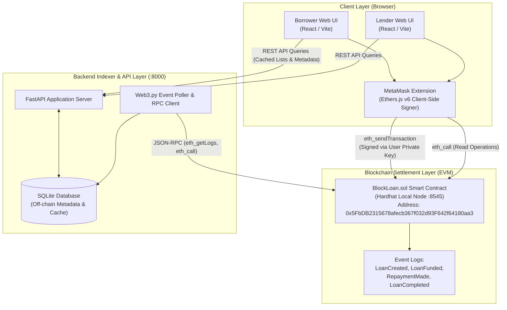
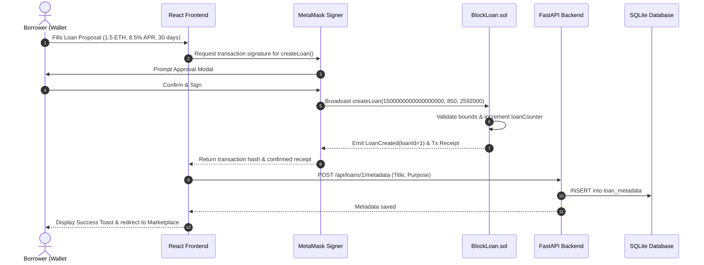
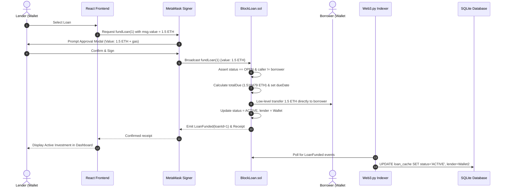
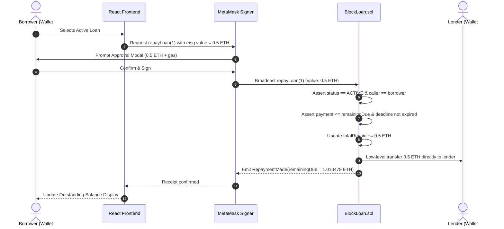

# BlockLoan — System Architecture & Data Flow

**Document**: System Architecture Specification  
**System Name**: BlockLoan Decentralized P2P Lending Platform  
**Target Environment**: Hardhat Local Network (`31337`) / Ethereum Sepolia Testnet  

---

## 1. Architectural Overview & System Topology

BlockLoan is architected as a **non-custodial decentralized financial application (DApp)**. The system decouples financial consensus and transaction execution from off-chain presentation and indexing:

1. **Decentralized Settlement Layer (Solidity on EVM)**:
   The ultimate source of truth for all loan states, balances, interest accrual, and funds routing.
2. **Client Presentation Layer (React + Vite + Tailwind)**:
   A responsive, client-side Web3 dashboard connecting directly to the user's browser-injected Ethereum provider (MetaMask via Ethers.js v6).
3. **Indexer & Application Service Layer (FastAPI + Web3.py)**:
   A read-only backend that listens for blockchain events, caches loan states in SQLite, and provides high-speed queries, system health diagnostics, and off-chain descriptive metadata without requiring private keys.

---

## 2. Core Protocol Sequence Diagrams

### 2.1 Loan Request Creation Flow
The borrower initiates a loan request. The transaction is signed locally by MetaMask and broadcasted to the EVM. The backend indexes the event and stores the user-provided title/purpose in SQLite.

---

### 2.2 Peer Funding Flow
A lender inspects open proposals in the marketplace, selects a loan, and supplies the exact principal in test ETH. The smart contract immediately transfers the principal to the borrower's address and activates the loan.

---

### 2.3 Repayment & Settlement Flow
The borrower services their debt by calling `repayLoan`. Funds are forwarded directly to the lender. When total repayments equal total due, the loan status transitions to `COMPLETED`.

---

## 3. Trust Boundaries & Security Model

| Boundary | Interaction | Trust Level | Security Enforcement |
| :--- | :--- | :---: | :--- |
| **User &rarr; MetaMask** | Key storage and signing | **Zero Trust** | Private keys are locked inside user's local browser extension; never transmitted over network. |
| **MetaMask &rarr; EVM** | Value-bearing transactions | **Algorithmic Trust** | Enforced by EVM opcodes and smart contract code (`nonReentrant`, explicit reverts). |
| **Frontend &rarr; Backend** | Read queries & metadata | **Low Trust** | Backend is read-only; compromised backend cannot steal user funds or alter blockchain state. |
| **Backend &rarr; EVM** | Web3.py RPC indexer | **Read-Only** | Uses read-only calls (`eth_getLogs`, `eth_call`). Backend holds zero private keys. |
| **Backend &rarr; Database** | SQLite persistence | **Local Enclave** | Parameterized queries with SQLAlchemy ORM; generic error handlers prevent SQL injection and schema leakage. |

---

## 4. Data Layer Architecture

### 4.1 On-Chain Data Model (`BlockLoan.sol`)
Stores state variables required for financial execution:
- `id`: Sequential `uint256`
- `borrower`: `address payable`
- `lender`: `address payable`
- `principalAmount`: `uint256` (wei)
- `interestRateBps`: `uint256` (basis points)
- `durationSeconds`: `uint256` (seconds)
- `createdAt`: `uint256` (timestamp)
- `fundedAt`: `uint256` (timestamp)
- `repaymentDeadline`: `uint256` (timestamp)
- `totalDue`: `uint256` (wei)
- `totalRepaid`: `uint256` (wei)
- `status`: `enum LoanStatus { OPEN, ACTIVE, COMPLETED, DEFAULTED, CANCELLED }`

### 4.2 Off-Chain Database Model (`backend/app/database/models.py`)
- **`LoanMetadata`**:
  - `loan_id` (`Integer`, Primary Key)
  - `title` (`String(120)`)
  - `purpose` (`Text`)
  - `created_at` (`DateTime`)
  - `updated_at` (`DateTime`)
- **`UserProfile`**:
  - `wallet_address` (`String(42)`, Primary Key, checksummed)
  - `display_name` (`String(60)`)
  - `bio` (`Text`)
  - `created_at` (`DateTime`)
- **`LoanCache`**:
  - Mirrored copy of on-chain fields to accelerate marketplace queries when node is under heavy load.
