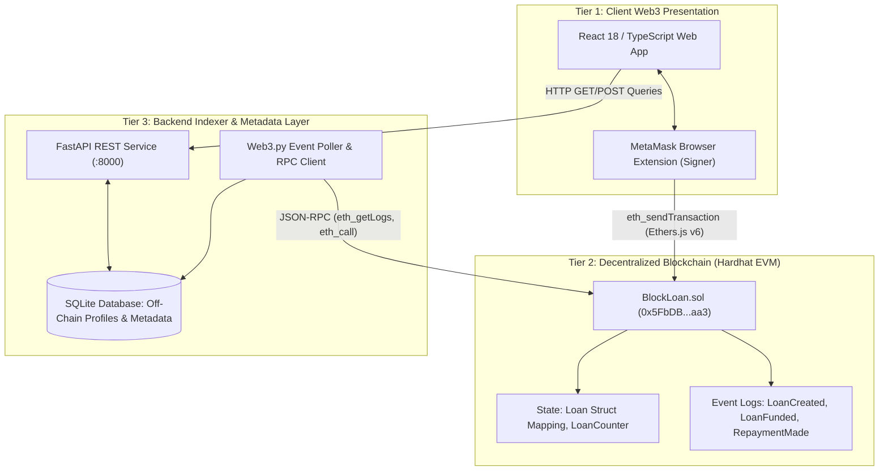

# BlockLoan: Blockchain-Based Decentralized Peer-to-Peer Lending Platform
## College Mini-Project Formal Technical Report

---

### Project Metadata
- **Project Title**: BlockLoan — Blockchain-Based Decentralized Peer-to-Peer Lending Platform
- **Academic Discipline**: Computer Science & Engineering / Information Technology (Blockchain & Distributed Systems)
- **Development Stack**: Solidity (`^0.8.20`), React (`v18`), Vite, TypeScript, Tailwind CSS, Ethers.js (`v6`), Python (`v3.14`), FastAPI (`v0.115`), Web3.py (`v8`), SQLite, SQLAlchemy (`v2.0`), Hardhat
- **Status**: Production Prototype (Phases 1 through 8 Complete)

---

## 1. Abstract

Commercial consumer lending and micro-credit systems are predominantly governed by centralized banking corporations, credit-scoring bureaus, and financial intermediaries. These centralized architectures suffer from systemic frictions, including exorbitant loan processing fees, opaque underwriting criteria, geographic exclusions, counterparty risks, and prolonged settlement delays. 

This project introduces **BlockLoan**, an educational, non-custodial decentralized peer-to-peer (P2P) lending protocol built atop Ethereum-compatible smart contracts. BlockLoan establishes an autonomous debt agreement marketplace where borrowers can request loans with user-specified principal, interest rates, and durations, and prospective lenders can directly fund these requests without third-party escrow agents. Financial custody, repayment tracking, simple interest calculations, and default handling are mathematically enforced by an immutable Solidity smart contract (`BlockLoan.sol`). 

The decentralized application (DApp) combines a React/TypeScript web interface powered by Ethers.js and MetaMask for client-side transaction signing, alongside an asynchronous Python FastAPI backend utilizing Web3.py to provide read-only event indexing and off-chain metadata caching. The protocol was rigorously verified across 58 Solidity contract tests, 36 backend automated tests, and full two-wallet end-to-end integration lifecycle runs, confirming robust security invariants against reentrancy, unauthorized debt servicing, and payment discrepancies.

---

## 2. Introduction

Peer-to-peer lending emerged as a fintech alternative to traditional banking by connecting capital holders directly with credit seekers. However, traditional Web2 P2P lending platforms (such as LendingClub or Prosper) still retain centralized custody of user deposits, control algorithmic matching, and maintain centralized databases vulnerable to single points of failure, administrative corruption, and regulatory capture.

Blockchain technology—specifically Ethereum Virtual Machine (EVM) smart contracts—provides the foundation for programmable, non-custodial financial primitives known as Decentralized Finance (DeFi). In DeFi, code replaces institutional trust. Credit agreements can be formalized as self-executing contracts where loan parameters are immutable, disbursements are atomic, and repayment tracking is transparent to all network participants.

BlockLoan was developed as an academic engineering demonstration to explore the architecture, security models, data flows, and practical constraints of decentralized micro-lending on an EVM-compatible execution layer.

---

## 3. Problem Statement & Motivation

### 3.1 Problem Statement
Traditional lending ecosystems face three fundamental structural challenges:
1. **Intermediary Rent-Seeking**: Banks and brokerage institutions extract substantial loan origination fees, administrative charges, and high spreads between borrowing and lending rates.
2. **Opacity and Counterparty Bias**: Underwriting standards and interest calculations are black boxes, leaving retail borrowers subject to arbitrary rejections and predatory variable fees.
3. **Custodial Vulnerability & Settlement Latency**: Centralized custodial databases present high-value targets for data breaches, while traditional clearinghouses (ACH, wire transfers) require business days to settle funds.

### 3.2 Motivation
The motivation of BlockLoan is to construct a trust-minimized financial primitive that demonstrates how open cryptography and smart contracts can eliminate administrative overhead, guarantee mathematical financial settlement, and democratize access to credit without handing custody of private keys to any third party.

---

## 4. Project Objectives

The project is guided by the following primary engineering objectives:
1. **Decentralized Settlement**: Author, compile, and deploy an immutable Solidity contract (`BlockLoan.sol`) managing loan proposals, peer funding disbursements, linear simple interest calculations, and repayments.
2. **Non-Custodial Architecture**: Ensure zero developer or administrative access to user funds; all ETH movements are governed strictly by verifiable smart contract rules.
3. **Modern Web3 User Experience**: Develop an intuitive, accessible React/TypeScript dashboard with MetaMask integration, responsive financial cards, transaction lifecycle status modals, and zero misleading mock buttons.
4. **Resilient Off-Chain Indexing**: Implement a lightweight Python FastAPI backend with Web3.py and SQLite that caches immutable on-chain state, indexes contract event logs, and manages off-chain descriptive metadata without storing user private keys.
5. **Rigorous Security Verification**: Subject the system to extensive negative and boundary testing covering reentrancy, double funding, unauthorized repayments, overpayments, and premature default handling.

---

## 5. Existing vs. Proposed Systems

| Parameter | Existing Centralized System | Existing Web2 P2P Platform | Proposed BlockLoan System |
| :--- | :--- | :--- | :--- |
| **Custody of Funds** | Commercial Bank | Centralized Platform Escrow | **Non-Custodial Smart Contract Escrow** |
| **Trust Model** | Institutional & Legal | Corporate Reputation | **Algorithmic & Cryptographic (EVM)** |
| **Intermediary Fees** | 3% - 10% Processing Fees | 2% - 5% Platform Fees | **0% Platform Fees** (Only Network Gas) |
| **Settlement Time** | 2 to 7 Business Days | 1 to 3 Business Days | **Immediate** (Per Block Confirmation) |
| **Transparency** | Private Centralized Ledger | Internal SQL Database | **Public Immutable Ethereum Ledger** |
| **Data Privacy** | Full KYC, SSN, Credit Reports | Full Personal Identification | **Pseudonymous Ethereum Addresses** |
| **Admin Backdoors** | Account freezes by bank policy | Platform account suspension | **Zero Backdoors / No Pause Function** |

---

## 6. Hardware & Software Requirements

### 6.1 Hardware Requirements
- **Processor**: Intel Core i5 / AMD Ryzen 5 or higher (Dual-Core 2.0 GHz minimum)
- **RAM**: 8 GB RAM (16 GB recommended for concurrent node and server processes)
- **Storage**: 2 GB free SSD storage for dependencies, node state, and build artifacts
- **Network**: Local loopback interface (`127.0.0.1`)

### 6.2 Software Requirements
- **Operating System**: Microsoft Windows 10/11, macOS, or Ubuntu Linux
- **Node.js**: v18.0.0 or higher (v20+ LTS recommended) with `npm`
- **Python**: v3.10 to v3.14 with `pip` and virtual environment support
- **Blockchain Framework**: Hardhat `v2.22+`
- **Smart Contract Language**: Solidity `^0.8.20`
- **Browser & Wallet**: Google Chrome / Brave / Edge with **MetaMask Extension** installed

---

## 7. System Architecture & High-Level Design

The system adheres to a three-tier decentralized architecture:



---

## 8. Functional Modules Description

The application is decomposed into five core operational modules:

### 8.1 Borrower Module
- **Loan Proposal Submission**: Allows credit seekers to define desired principal, annual interest rate (in basis points), and loan tenure.
- **Collateral & Disbursal Tracking**: Monitors open requests; detects when peer funding occurs and instantly updates active balance.
- **Debt Servicing**: Facilitates partial payments or complete loan payoff directly to the lender's wallet address.

### 8.2 Lender Module
- **Decentralized Marketplace**: Displays all open credit proposals, sorting by yield (APR), duration, and requested principal.
- **Atomic Funding**: Executes single-transaction principal transfers directly to the borrower while atomically binding the lender to future repayment cash flows.
- **Portfolio Tracking**: Real-time view of active capital deployed, anticipated returns at maturity, and settlement histories.

### 8.3 Web3 Wallet & Connection Module
- **MetaMask Provider Detection**: Detects injected Ethereum provider, requests user authorization, and displays truncated account addresses (`0x7099...79C8`).
- **Chain Verification & Auto-Switching**: Validates connection to Localhost (`31337`), displaying non-intrusive warning banners and one-click network switching.
- **Client-Side Signature Security**: Protects user sovereignty by never exposing private keys to the frontend runtime or backend server.

### 8.4 Backend Indexer Module
- **RPC Diagnostics**: Periodically polls the local node for connectivity, block height, and contract runtime bytecode validation.
- **Event Log Parsing**: Indexes `LoanCreated`, `LoanFunded`, `RepaymentMade`, and `LoanCompleted` events into a query-optimized SQLite database.
- **Metadata Management**: Maps human-readable loan titles and project descriptions to numeric loan IDs without incurring EVM calldata storage gas costs.

### 8.5 Protocol Administration & Audit Module
- **Protocol Telemetry**: Aggregates macro metrics (total protocol volume, completed loan volume, default rate, average interest rate).
- **Node & Contract Audit**: Provides real-time technical diagnostics verifying that contract bytecode exists and matches expected deployment hashes.

---

## 9. Smart Contract Design & Implementation

### 9.1 Data Model & Status Enum
The contract implements a 5-state finite state machine:
```solidity
enum LoanStatus { OPEN, ACTIVE, COMPLETED, DEFAULTED, CANCELLED }

struct Loan {
    uint256 id;
    address payable borrower;
    address payable lender;
    uint256 principalAmount;
    uint256 interestRateBps;
    uint256 durationSeconds;
    uint256 createdAt;
    uint256 fundedAt;
    uint256 repaymentDeadline;
    uint256 totalDue;
    uint256 totalRepaid;
    LoanStatus status;
}
```

### 9.2 Core Mathematical Formulas
Linear interest is computed using fixed-point integer arithmetic in basis points (where $1\text{ bps} = 0.01\%$, and $10{,}000\text{ bps} = 100\%$):

$$\text{Interest} = \frac{\text{principalAmount} \times \text{interestRateBps} \times \text{durationSeconds}}{10{,}000 \times 31{,}536{,}000\text{ seconds}}$$
$$\text{TotalDue} = \text{principalAmount} + \text{Interest}$$

### 9.3 Security Invariants
- **No Residual Balance**: Contract balance is strictly 0 wei at rest; funds are immediately forwarded via low-level `.call{value: ...}("")`.
- **Checks-Effects-Interactions (CEI)**: State updates occur before value transfers.
- **Reentrancy Guard**: Reentrancy mutex modifier (`nonReentrant`) applied to `fundLoan` and `repayLoan`.
- **Self-Funding Prevention**: Explicit check `require(msg.sender != loan.borrower)` prevents wash volume.

---

## 10. Database Design & Off-Chain Service

The backend utilizes SQLite with SQLAlchemy ORM to manage auxiliary metadata:

### 10.1 Schema Definitions
1. **`loan_metadata`**:
   - `loan_id` (`INTEGER PRIMARY KEY`): References on-chain loan ID.
   - `title` (`VARCHAR(120)`): Borrower-provided proposal title.
   - `purpose` (`TEXT`): Detailed rationale for loan request.
   - `created_at` (`DATETIME`): Creation timestamp.
   - `updated_at` (`DATETIME`): Last edit timestamp.
2. **`user_profiles`**:
   - `wallet_address` (`VARCHAR(42) PRIMARY KEY`): Checksummed Ethereum address.
   - `display_name` (`VARCHAR(60)`): Optional pseudonym or enterprise name.
   - `bio` (`TEXT`): Profile biography.
   - `created_at` (`DATETIME`): Account registration timestamp.
3. **`loan_cache`**:
   - Caches immutable financial terms to ensure read availability even during temporary node reboots.

---

## 11. Frontend & Web3 Integration

- **Framework**: React 18 with Vite build bundler and TypeScript.
- **Styling**: Tailwind CSS configured with a dark navy palette (`#0B0E17`), subtle teal accents (`#14B8A6`), and financial status badges.
- **Web3 Interaction**: Ethers.js v6 `BrowserProvider` and `Contract` instances.
- **Error Handling**: Graceful interception of `ACTION_REJECTED` (user rejected in MetaMask), `INSUFFICIENT_FUNDS`, and custom contract revert errors (`BorrowerCannotFund`, `RepaymentExceedsBalance`).

---

## 12. Security Analysis & Vulnerability Mitigations

| Vulnerability Threat | Mitigation in BlockLoan |
| :--- | :--- |
| **Reentrancy Attack** | Implemented custom reentrancy mutex (`nonReentrant`); updated state before external calls. |
| **Integer Overflow / Underflow** | Built with Solidity `^0.8.20` featuring built-in overflow/underflow checks. |
| **Wash Trading / Self Funding** | `BorrowerCannotFund` revert prevents a borrower from artificially inflating volume. |
| **Unauthorized Debt Servicing** | `OnlyBorrowerCanRepay` restricts repayments to the original borrower address. |
| **Overpayment Fund Loss** | `RepaymentExceedsBalance` immediately reverts any payment exceeding exact balance due. |
| **SQL Injection** | SQLAlchemy ORM parameterized queries; verified with automated SQL injection test vectors. |
| **Cross-Site Scripting (XSS)** | React JSX automatic string escaping on user profiles and metadata inputs. |
| **Internal Stack Leakage** | Global exception handlers mask internal database tracebacks with generic client responses. |

---

## 13. Testing Methodology & Verification Results

Testing was conducted across three distinct test runners:

### 13.1 Smart Contract Test Suite (Hardhat / Chai)
- **Results**: **58 passed (0 failed)** across 3 test files.
- **Coverage**:
  - Loan Creation (parameter bounds, minimum thresholds): 4 tests.
  - Loan Funding (state transitions, self-funding rejection): 5 tests.
  - Repayments & Settlement (partial/full settlement, overpayment rejection): 6 tests.
  - Deadline & Default Behavior (premature default rejection, post-deadline settlement): 4 tests.
  - Cancellation & Nonexistent resources: 4 tests.
  - Multi-Wallet Integration: 6 tests.
  - Security Negative & Boundary Tests: 29 tests.

### 13.2 Backend Service Test Suite (Pytest)
- **Results**: **36 passed (0 failed)**.
- **Coverage**: RPC connectivity, contract deployment detection, loan status mapping, metadata persistence, security negative tests (invalid IDs, SQL injection payloads, XSS strings, private key absence checks).

### 13.3 End-to-End Two-Wallet Integration Test
- Automated script (`scripts/e2ePhase6Integration.js`) successfully executed a 7-stage live lifecycle on the Hardhat node, confirming that Account #1 received principal from Account #2, completed two partial payments, transitioned to `COMPLETED`, and synchronized across the FastAPI indexer.

---

## 14. Advantages & Limitations

### 14.1 Key Advantages
1. **Zero Financial Intermediary**: Removes loan origination spreads and centralized bank management.
2. **Atomic Non-Custodial Settlement**: Direct wallet-to-wallet value routing prevents custodial insolvency.
3. **Mathematically Auditable**: Transparent interest calculation logic verifiable by all parties.
4. **Instant Liquidity**: Approved funds disburse immediately upon block confirmation.

### 14.2 Technical Limitations
1. **Push Payment Vulnerability**: Direct `.call` transfers can revert if the recipient is an uncooperative contract.
2. **Simple vs. Amortized Interest**: Interest does not dynamically discount for early repayments.
3. **Absence of Collateral Escrow**: Current model relies on bilateral peer trust; bad debt defaults cannot be liquidated on-chain without an overcollateralized deposit.
4. **Asset Volatility**: Loans denominated in native ETH expose parties to cryptocurrency price fluctuations without a stablecoin or oracle peg.

---

## 15. Demonstration Scenarios & Validation

The platform was validated through five rigorous operational scenarios:
1. **Normal Loan Request & Peer Funding**: Borrower requests 1.5 ETH; Lender funds proposal; Borrower receives 1.5 ETH; Loan transitions to `ACTIVE`.
2. **Negative Self-Funding Scenario**: Borrower attempts to fund their own loan; contract reverts with `BorrowerCannotFund()`.
3. **Debt Servicing (Partial & Full)**: Borrower pays 0.5 ETH (remaining: 1.01 ETH); Borrower settles remaining balance; contract marks loan `COMPLETED`.
4. **Negative Unauthorized Repayment**: Stranger account attempts to repay debt; contract reverts with `OnlyBorrowerCanRepay()`.
5. **Default Verification**: Time elapsed past repayment deadline; contract successfully marks state as `DEFAULTED`.

---

## 16. Future Scope & Roadmap

1. **ERC-20 Stablecoin Support**: Expand protocol to accept USDC and DAI to eliminate crypto price volatility risks.
2. **Chainlink Decentralized Oracles**: Integrate real-time price feeds for multi-asset collateralization ratios.
3. **Overcollateralized Escrow Vaults**: Implement locked crypto collateral (e.g. 150% ratio) with automated liquidation bots.
4. **Syndicated Liquidity Pools**: Enable multiple lenders to contribute fractional shares of large loan proposals.
5. **Decentralized Identity (DID) & Soulbound Credit Scores**: Issue non-transferable on-chain reputation badges to reward consistent repayment behavior.

---

## 17. Conclusion & References

### 17.1 Conclusion
The **BlockLoan** project successfully demonstrates the design, implementation, and verification of a decentralized, non-custodial peer-to-peer lending protocol. By replacing centralized loan intermediaries with deterministic Solidity smart contracts, the platform guarantees algorithmic financial execution, eliminates predatory fee structures, and preserves user financial sovereignty. The comprehensive verification suite (58 smart contract tests, 36 backend tests, and E2E lifecycle runs) confirms that the application is secure, resilient, and ready for college academic evaluation and defense.

### 17.2 References
1. Antonopoulos, A. M., & Wood, G. (2018). *Mastering Ethereum: Building Smart Contracts and DApps*. O'Reilly Media.
2. Buterin, V. (2014). *Ethereum Whitepaper: A Next-Generation Smart Contract and Decentralized Application Platform*.
3. Gudgeon, L., Perez, D., Harz, D., Livshits, B., & Gervais, A. (2020). The Decentralized Financial Sky: The Good, the Bad, and the Ugly. *IEEE CryptoValley Conference*.
4. Solidity Documentation (v0.8.20). *Solidity Language Specifications*. Ethereum Foundation.
5. Ethers.js Documentation (v6). *Complete Ethereum Client Library Reference*.
6. FastAPI Documentation. *Modern, Fast Web Framework for Python 3.10+*.
7. Hardhat Documentation. *Ethereum Development Environment for Professionals*. Nomic Foundation.
