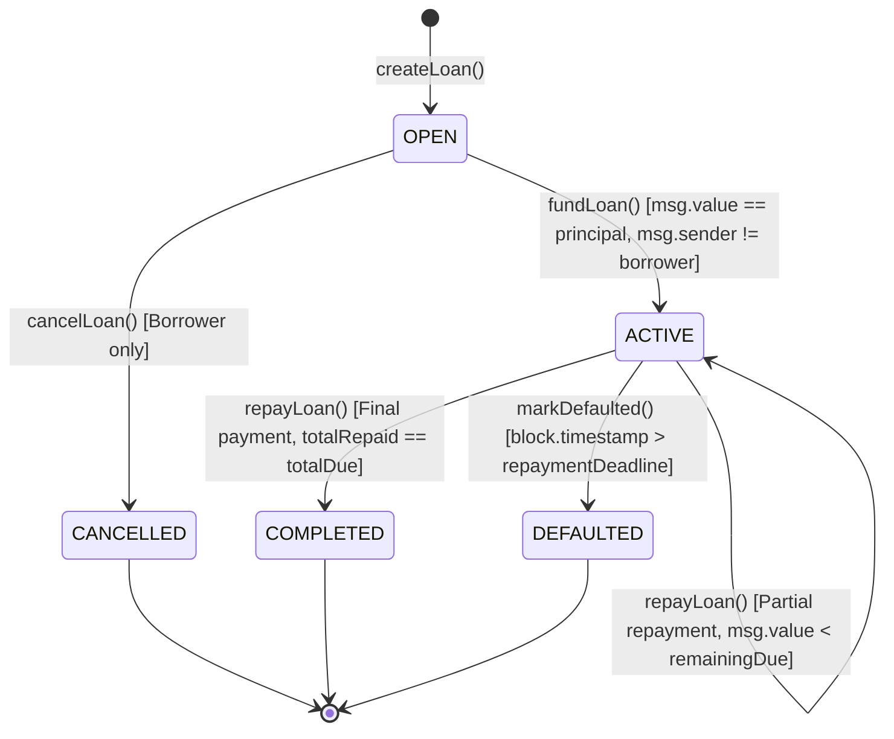

# BlockLoan — Smart Contract Technical Specification

**Contract Name**: [`BlockLoan.sol`](file:///c:/Users/Umer%20Khan/OneDrive/Desktop/BT%20Mini%20Project/blockchain/contracts/BlockLoan.sol)  
**Compiler**: Solidity `^0.8.20`  
**License**: MIT  
**Target Environment**: Hardhat Local Network (`chainId: 31337`) / Ethereum Sepolia Testnet  
**Deployed Address (Local)**: `0x5FbDB2315678afecb367f032d93F642f64180aa3`

---

## 1. Overview & Architectural Principles

[`BlockLoan.sol`](file:///c:/Users/Umer%20Khan/OneDrive/Desktop/BT%20Mini%20Project/blockchain/contracts/BlockLoan.sol) is an autonomous, non-custodial smart contract powering a peer-to-peer (P2P) lending protocol. It replaces traditional intermediaries (banks, underwriters, loan brokers) with immutable code running on the Ethereum Virtual Machine (EVM).

### Key Architectural Invariants
1. **Zero Trapped Balances**: The contract contract balance is strictly transient. When a lender funds a loan, the principal is directly pushed to the borrower. When the borrower repays, the repayment is directly forwarded to the lender. The contract balance remains `0 wei` before and after transactions.
2. **Zero Centralized Privileges**: There is no contract owner, no admin backdoor, no pause mechanism that can freeze user assets, and no fee skimming.
3. **Checks-Effects-Interactions (CEI)**: Every state-modifying function applies validation checks first, updates internal storage (`_loans`), and performs external ETH value transfers last.
4. **Reentrancy Protection**: Protected by custom mutex modifier `nonReentrant` on all value-bearing entrypoints.
5. **Exact Payment Matching**: Exact principal must be supplied during funding. Overpayments during repayment revert to prevent accidental fund loss.

---

## 2. State Machine & Lifecycle Transitions

A loan progresses through five deterministic states:



### State Definitions

| State | Enum Value | Description |
| :--- | :---: | :--- |
| `OPEN` | `0` | Loan request is created by the borrower and listed in the marketplace. Awaiting peer funding. |
| `ACTIVE` | `1` | Loan funded by a lender. Principal transferred to borrower; duration countdown started. |
| `COMPLETED` | `2` | Loan fully settled with interest before deadline. Obligations completely cleared. |
| `DEFAULTED` | `3` | Repayment deadline expired without full repayment. Marked permissionlessly on-chain. |
| `CANCELLED` | `4` | Cancelled by borrower prior to peer funding. Request permanently removed from marketplace. |

---

## 3. Data Structures

### `struct Loan`
```solidity
struct Loan {
    uint256 id;                 // Unique sequential loan identifier (1, 2, 3...)
    address payable borrower;   // Account that created the request and receives principal
    address payable lender;     // Account that supplied principal and receives repayments
    uint256 principalAmount;   // Principal requested in wei
    uint256 interestRateBps;   // Annual percentage rate in basis points (e.g., 850 = 8.50%)
    uint256 durationSeconds;   // Loan tenure in seconds once funded
    uint256 createdAt;         // Block timestamp when loan was created
    uint256 fundedAt;          // Block timestamp when lender funded the loan
    uint256 repaymentDeadline; // Block timestamp (fundedAt + durationSeconds) for due date
    uint256 totalDue;          // Total repayment obligation (principal + simple interest) in wei
    uint256 totalRepaid;       // Cumulative wei repaid to date
    LoanStatus status;         // Current lifecycle state (OPEN, ACTIVE, COMPLETED, DEFAULTED, CANCELLED)
}
```

---

## 4. Financial Calculations & Formulas

### Interest Accrual Formula
BlockLoan employs linear simple interest calculated over the exact tenure in seconds:

$$\text{Interest (wei)} = \left\lfloor \frac{\text{Principal} \times \text{InterestRateBps} \times \text{DurationSeconds}}{\text{BPS\_DIVISOR} \times \text{SECONDS\_PER\_YEAR}} \right\rfloor$$

Where:
- $\text{BPS\_DIVISOR} = 10{,}000$ (so $100\text{ bps} = 1.00\%$)
- $\text{SECONDS\_PER\_YEAR} = 365\text{ days} = 31{,}536{,}000\text{ seconds}$
- Division truncates towards zero (standard Solidity integer arithmetic)

### Total Amount Due
$$\text{TotalDue (wei)} = \text{Principal} + \text{Interest}$$

### Example Calculation
For a loan of **1.0 ETH** ($10^{18}$ wei) at **8.50% APR** ($850$ bps) for **30 days** ($2{,}592{,}000$ seconds):
$$\text{Interest} = \frac{10^{18} \times 850 \times 2{,}592{,}000}{10{,}000 \times 31{,}536{,}000} \approx 6{,}986{,}301{,}369{,}863{,}013\text{ wei} \approx 0.006986\text{ ETH}$$
$$\text{TotalDue} = 1.006986301369863013\text{ ETH}$$

---

## 5. Contract Function Reference

### 5.1 `createLoan`
```solidity
function createLoan(
    uint256 principal,
    uint256 interestRateBps,
    uint256 durationSeconds
) external returns (uint256 loanId)
```
- **Description**: Creates a new open loan proposal.
- **Access**: Any Ethereum address (except zero address).
- **Validations**:
  - `principal >= MIN_PRINCIPAL` (`1000 wei`)
  - `MIN_INTEREST_RATE_BPS <= interestRateBps <= MAX_INTEREST_RATE_BPS` (`50 bps` to `5000 bps`, or 0.5% to 50.0%)
  - `MIN_DURATION <= durationSeconds <= MAX_DURATION` (`1 hours` to `365 days`)
- **State Modifications**:
  - Increments `loanCounter`.
  - Sets borrower to `msg.sender`, lender to `address(0)`, status to `LoanStatus.OPEN`.
- **Emits**: `LoanCreated(loanId, borrower, principal, interestRateBps, durationSeconds)`.

---

### 5.2 `fundLoan`
```solidity
function fundLoan(uint256 loanId) external payable nonReentrant
```
- **Description**: Supplies principal in native ETH and activates the debt agreement.
- **Access**: Any account **except** the loan's borrower (prevents self-funding wash transactions).
- **Validations**:
  - `1 <= loanId <= loanCounter`
  - `loan.status == LoanStatus.OPEN`
  - `msg.sender != loan.borrower`
  - `msg.value == loan.principalAmount`
- **State Modifications**:
  - Computes `totalDue = calculateRepaymentAmount(...)`.
  - Assigns `loan.lender = payable(msg.sender)`.
  - Records `loan.fundedAt = block.timestamp`.
  - Sets `loan.repaymentDeadline = block.timestamp + loan.durationSeconds`.
  - Updates `loan.status = LoanStatus.ACTIVE`.
  - Transfers `msg.value` directly to `loan.borrower` via low-level `.call{value: msg.value}("")`.
- **Emits**: `LoanFunded(loanId, lender, totalDue, repaymentDeadline)`.

---

### 5.3 `repayLoan`
```solidity
function repayLoan(uint256 loanId) external payable nonReentrant
```
- **Description**: Submits partial or full repayment towards active debt.
- **Access**: **Borrower only** (`msg.sender == loan.borrower`).
- **Validations**:
  - `1 <= loanId <= loanCounter`
  - `loan.status == LoanStatus.ACTIVE`
  - `msg.sender == loan.borrower`
  - `msg.value > 0`
  - `block.timestamp <= loan.repaymentDeadline`
  - `msg.value <= (loan.totalDue - loan.totalRepaid)` (prevents overpayment)
- **State Modifications**:
  - Increases `loan.totalRepaid += msg.value`.
  - If `loan.totalRepaid == loan.totalDue`, updates `loan.status = LoanStatus.COMPLETED`.
  - Forwards `msg.value` directly to `loan.lender` via `.call{value: msg.value}("")`.
- **Emits**: 
  - `RepaymentMade(loanId, borrower, amountPaid, remainingDue)`
  - `LoanCompleted(loanId, borrower, lender, totalRepaid)` (if settled in full).

---

### 5.4 `markDefaulted`
```solidity
function markDefaulted(uint256 loanId) external
```
- **Description**: Permissionlessly marks an overdue loan as defaulted.
- **Access**: Public (anyone may trigger state transition after due date).
- **Validations**:
  - `1 <= loanId <= loanCounter`
  - `loan.status == LoanStatus.ACTIVE`
  - `block.timestamp > loan.repaymentDeadline`
- **State Modifications**:
  - Updates `loan.status = LoanStatus.DEFAULTED`.
- **Emits**: `LoanDefaulted(loanId, borrower, lender, unpaidAmount)`.

---

### 5.5 `cancelLoan`
```solidity
function cancelLoan(uint256 loanId) external
```
- **Description**: Cancels an open loan request before any lender funds it.
- **Access**: **Borrower only**.
- **Validations**:
  - `1 <= loanId <= loanCounter`
  - `loan.status == LoanStatus.OPEN`
  - `msg.sender == loan.borrower`
- **State Modifications**:
  - Updates `loan.status = LoanStatus.CANCELLED`.
- **Emits**: `LoanCancelled(loanId, borrower)`.

---

### 5.6 View / Pure Helpers
- `getLoan(uint256 loanId) external view returns (Loan memory)`: Returns full loan struct.
- `getLoanCount() external view returns (uint256)`: Returns total number of created loans.
- `getRepaymentAmount(uint256 loanId) external view returns (uint256)`: Returns remaining due in wei (`0` if COMPLETED).
- `calculateRepaymentAmount(uint256 principal, uint256 interestRateBps, uint256 durationSeconds) public pure returns (uint256)`: Pure mathematical calculation function.

---

## 6. Events Log Reference

```solidity
event LoanCreated(uint256 indexed loanId, address indexed borrower, uint256 principalAmount, uint256 interestRateBps, uint256 durationSeconds);
event LoanFunded(uint256 indexed loanId, address indexed lender, uint256 totalDue, uint256 repaymentDeadline);
event RepaymentMade(uint256 indexed loanId, address indexed borrower, uint256 amountPaid, uint256 remainingDue);
event LoanCompleted(uint256 indexed loanId, address indexed borrower, address indexed lender, uint256 totalRepaid);
event LoanDefaulted(uint256 indexed loanId, address indexed borrower, address indexed lender, uint256 unpaidAmount);
event LoanCancelled(uint256 indexed loanId, address indexed borrower);
```

---

## 7. Security Invariants & Defensive Protections

| Threat | Defensive Countermeasure |
| :--- | :--- |
| **Reentrancy Attack** | `nonReentrant` modifier with custom mutex; storage state (`status`, `totalRepaid`) updated before external `.call`. |
| **Borrower Self-Funding** | `if (msg.sender == loan.borrower) revert BorrowerCannotFund();` prevents wash trades. |
| **Unauthorized Repayment** | `if (msg.sender != loan.borrower) revert OnlyBorrowerCanRepay();` prevents third-party interference. |
| **Overpayment Trapping** | `if (msg.value > remainingDue) revert RepaymentExceedsBalance();` prevents trapped excess ETH. |
| **Double Funding** | `if (loan.status != LoanStatus.OPEN) revert InvalidLoanStatus();` guarantees single-lender exclusivity. |
| **Premature Default** | `if (block.timestamp <= loan.repaymentDeadline) revert DeadlineNotPassed();` protects borrower window. |
| **Direct ETH Trapping** | No `receive()` or `fallback()` functions; direct transfers without function call revert automatically. |
